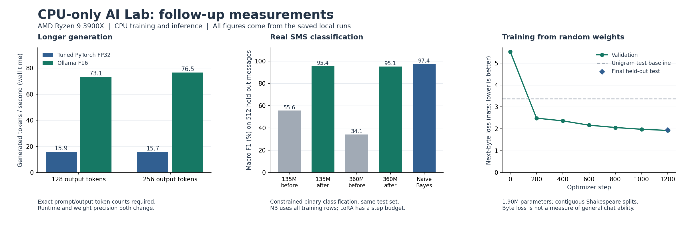

# CPU-only AI Lab

Reproducible language-model training, adaptation, and inference using a CPU and system RAM. The project measures whether training improves a held-out task and whether an inference change improves speed without unacceptable task-quality loss.

Read the [project goal and acceptance criteria](GOAL.md).

## What the experiments do

| Experiment | Model | Change being measured |
| --- | --- | --- |
| CPU training | `HuggingFaceTB/SmolLM2-135M-Instruct` | Train LoRA adapters for extracting two integer fields from text into JSON; compare held-out loss and generated answers before and after training. |
| Small-model inference | The same trained 135M model | Merge its saved adapter, compare FP32 with dynamic INT8 linear layers, and retain INT8 only if the validation-quality and measured-speed gates pass. |
| Existing-model inference | Ollama `qwen2.5-coder:7b` | Tune CPU thread count while keeping model digest, quantization, context, and generation budget fixed; confirm the selected setting on separate prompts. |

The training experiment does **not** train the 7B model. The pretrained 135M base was trained elsewhere; this project makes its local adaptation and inference CPU-only. The synthetic task measures copying fields into a specified format, not general reasoning, coding ability, or overall language-model quality.

## Results

Measured on an AMD Ryzen 9 3900X (12 physical cores), approximately 32 GiB RAM, Windows 11. Model workloads ran sequentially. Numerical reports are in [`results/`](results/); downloaded weights, local adapters, and environments remain outside Git.

### Follow-up: longer generation and real data



The longer-output experiment uses the original **trained extraction checkpoint**, separate from the SMS classifiers below. It retuned the PyTorch baseline on separate prompts, selecting **one thread** from 1, 2, 4, 6, and 12. Ollama used four threads. It then ran four predetermined prompt families at 128- and 256-token caps, three times each. **18/18 complete fixed-work pairs were faster**, with a **4.767x median paired speedup** and aggregate wall-clock throughput **15.78 -> 75.32 generated tokens/s**. The remaining six pairs all stopped naturally at 46 tokens and remain in the report; they do not contribute to the long-output speed figure. Output text matched between backends in all 24 pairs.

| Output budget | Matched long-output pairs | PyTorch FP32 tokens/s | Ollama F16 tokens/s | Median paired speedup |
| --- | ---: | ---: | ---: | ---: |
| 128 | 9 | 15.88 | 73.09 | 4.708x |
| 256 | 9 | 15.73 | 76.49 | 4.926x |

Median first-content latency across all requests was **310 ms -> 145 ms**. These wall timings include prompt processing, with loading/reset excluded. The runtime and weight-storage precision both change; this is not an isolated kernel comparison. The 4.767x result and the earlier 3.779x result use different workloads and should not be combined. [Raw longer-output measurements](results/extended-benchmark.json), [full methods and commands](EXPERIMENTS.md).

Manual inspection found poor general usefulness despite matching text: forest descriptions contradicted themselves, travel tips repeated, and generated sorting code contained obvious errors. Code was inspected, not executed. Faster generation and identical output do not establish useful long-form answers or correct code. The raw-completion workload also differs from the trained JSON task.

The original longer-output report's Ollama RAM counter missed the separate `llama-server.exe` process. Its Ollama RSS total is **incomplete and must not be interpreted as inference RAM**. The raw report is preserved with a [correction note](results/extended-benchmark-notes.json). A separate corrected probe measured **462.67 MiB** sampled peak RSS across the Ollama process tree, including the native runner, and confirmed **zero VRAM**. Ollama reported a 333,929,511-byte model allocation; that is a different measure from process RSS. This probe had no resident PyTorch model, so it is not a matched memory comparison with the earlier paired benchmark. [Memory evidence](results/backend-memory.json).

For a real task, 135M and 360M models were adapted to the public **UCI SMS Spam Collection**. Near-duplicate groups were reduced before seeded train/validation/test splits. Classification uses only two allowed next-token labels, not free-form answers. The held-out test has 512 messages, including 55 spam messages. Both models use exactly the same split manifests and 120-update training schedule.

| Classifier | Test correct | Accuracy | Macro F1 |
| --- | ---: | ---: | ---: |
| Always predict the training-majority label | 457/512 | 89.26% | 0.472 |
| 135M before adaptation | 442/512 | 86.33% | 0.556 |
| 135M after adaptation | 503/512 | 98.24% | 0.954 |
| 360M before adaptation | 215/512 | 41.99% | 0.341 |
| 360M after adaptation | 502/512 | 98.05% | 0.951 |
| Naive Bayes, same 389 unique rows seen by selected 135M checkpoint | 496/512 | 96.88% | 0.927 |
| Naive Bayes, same 329 unique rows seen by selected 360M checkpoint | 488/512 | 95.31% | 0.896 |
| Naive Bayes, all 1,400 available training rows | 507/512 | 99.02% | 0.974 |

The 135M run used 120 updates with balanced four-example batches: 480 presentations of 389 unique records. The training loop, including validation, took **349.10 seconds**; the entire load/train/before-and-after evaluation run took **610.50 seconds**. Sampled peak process RSS was **1.88 GiB**. Naive Bayes fitting and validation selection on all available training data took **0.057 seconds**, excluding Python startup. The inexpensive classifier was the best measured choice on the full available training set; the LoRA model outperformed the baseline given only its 389 seen records. This does not establish a general algorithm ranking. [135M metrics and predictions by record hash](results/real-task-135m.json).

The 360M model trained 819,200 adapter parameters on a 361,821,120-parameter base. It selected step **90** using validation results; the final 30 steps reduced validation macro F1. Training and validation took **886.67 seconds** (14 min 47 sec), **2.54x** the 135M loop time. The entire run took **1,576.45 seconds** (26 min 16 sec), with **3.41 GiB** sampled peak RSS. Its selected checkpoint had seen 329 unique messages. It produced one fewer correct test answer than the smaller model, so this run provides no accuracy reason to pay the extra CPU/RAM cost. This small difference is descriptive, not a statistical model ranking. [360M metrics](results/real-task-360m.json), [shared split manifest](results/real-task-splits.json).

A follow-up selected decision thresholds on validation data only. It retained **0.5** for both trained models, so there was **no additional trained-model test improvement**. Original fixed-threshold metrics remain primary. [135M threshold analysis](results/real-task-135m-calibration.json), [360M threshold analysis](results/real-task-360m-calibration.json).

These are historical public messages, not current production traffic. Pretraining contamination cannot be ruled out, near-duplicate grouping is heuristic, and one long test message was truncated to fit the input budget. Scores are conditional on two labels and are not calibrated production probabilities. Dataset attribution, split methodology, inference commands, and limitations are in [EXPERIMENTS.md](EXPERIMENTS.md).

### Follow-up: training entirely from random weights

A new **1,902,720-parameter byte-level transformer** was trained on CPU without loading pretrained weights or a learned tokenizer. It used 1,200 updates on the training portion of the tiny Shakespeare corpus, with contiguous 90%/5%/5% source splits. Every held-out next-byte target was scored once, and only validation loss selected the checkpoint.

| Held-out measure | Random initialization | Train-only unigram baseline | Trained transformer |
| --- | ---: | ---: | ---: |
| Next-byte loss, nats | 5.5265 | 3.3622 | **1.9512** |
| Byte perplexity | 251.25 | 28.85 | **7.04** |

The training loop took **209.96 seconds** (3 min 30 sec), including validation; the entire run took **220.33 seconds**. It processed 1,228,800 training target bytes and used **415 MiB** sampled peak process RSS. All parameters and optimizer tensors were on CPU. Initial and trained state checksums differ, and reloading the saved safetensors checkpoint reproduced the selected state exactly. [Metrics and generated samples](results/scratch.json), [learning curve](results/scratch-learning-curve.json), [corpus provenance](results/scratch-data-provenance.json), [20-step runtime calibration](results/scratch-calibration.json).

This demonstrates full CPU training and learned text patterns. Generated samples remain word-like but ungrammatical and unreliable; this is not a useful general assistant. Byte perplexity is not comparable to the subword-token losses of the other models. Natural repeated phrases can occur across the contiguous source splits.

The expanded suite has **81 passing tests**. Saved classifiers and the scratch model also passed artifact-loading/CLI execution checks. Those checks are not an accuracy benchmark: the 360M classifier labeled an illustrative prize message as legitimate while Naive Bayes labeled it as spam, showing that the held-out score does not guarantee every new answer. [Recorded functional checks](results/reload-smoke.json).

### Initial extraction proof and deployment experiments

| CPU training measurement | Before | After |
| --- | ---: | ---: |
| Held-out JSON exact match (32 examples) | 0/32 | 32/32 |
| Held-out target-token loss | 0.541428 | 0.000416 |

The run trained **460,800 LoRA parameters** on a 134,515,008-parameter base for 40 optimizer steps. It processed 160 training examples from the 192-example training split. The optimizer loop took **63.23 seconds including validation** (46.02 seconds of training compute); the full load/train/before-and-after evaluation run took **199.12 seconds**. Sampled peak process RSS was **1.53 GiB**. The saved adapter is approximately **1.86 MB** locally. These are narrow format-and-copying task results, not a general intelligence improvement.

Sources: [training metrics and raw predictions](results/training.json), [learning curve](results/training-curve.json), [resolved training settings](results/training-config.json), [exact synthetic datasets](results/data/), [hardware](results/hardware.json).

The unchanged 7B model's 4-thread candidate showed only **1.013x median paired decoding throughput** versus 12 threads, winning **3 of 6 pairs**. That is not a reliable speedup. The reusable chat command retains the baseline. Aggregate rates were 5.93 versus 5.88 tokens/s; the median paired ratio and aggregate ratio are different summary statistics. [Raw tuning and confirmation results](results/inference.json).

Quantizing all linear layers of the trained small model produced **1.679x throughput** (15.68 to 26.33 generated tokens/s, including prompt processing), but validation JSON accuracy dropped from **32/32 to 19/32**. It was **rejected**. [Full INT8 experiment](results/optimization.json).

Quantizing only MLP projections produced **1.331x throughput**, but validation accuracy was **21/32**, so it was also rejected. Merging the adapter without quantization gave a smaller **1.039x aggregate throughput** improvement (14.64 to 15.21 tokens/s), with **32/32 test answers correct** in both versions. These comparisons have separate paired baselines; their speedup ratios should not be multiplied. [MLP INT8 experiment](results/optimization-mlp.json), [FP32 merging experiment](results/merge.json).

**Selected deployment: merged F16 GGUF in Ollama/llama.cpp, forced to CPU.** The 16-token confirmation measured **3.779x median paired speedup** over merged FP32 PyTorch: aggregate **14.29 -> 54.17 generated tokens/s**, including prompt processing. All **6/6 pairs** were faster; prompt and output token counts matched and sampled generated outputs were identical. Both deployments scored **32/32** on the saved held-out extraction task. This combines a runtime change with FP32-to-F16 storage, not a claim about kernels alone. [Confirmation and raw outputs](results/backend-f16-confirmation.json).

The initial 32-token deployment experiment measured **4.483x median speedup** on three matched pairs. Three other pairs were excluded because Ollama naturally stopped at 18 tokens while PyTorch was forced to 32. The 16-token confirmation above includes both prompts without exclusions and is the primary reported deployment result. [Initial deployment experiment](results/backend-f16.json).

The test set is small and synthetic. These findings establish local CPU training and a faster deployment for this checkpoint/workload, not preserved quality across general language-model tasks. The optimized model is installed locally as `cpu-ai-lab-smollm2:trained-f16`; its weights are not pushed to GitHub.

## Windows setup

Requirements: Git, PowerShell, [uv](https://docs.astral.sh/uv/getting-started/installation/), and sufficient free disk space and RAM for the chosen model. Setup uses Python 3.12 by default. Network access is needed for dependencies and the first model download.

```powershell
git clone https://github.com/AliMa3s/cpu-only-ai-lab.git
Set-Location cpu-only-ai-lab
& .\scripts\setup.ps1

# Set these again in each new shell.
$env:HF_HOME = Join-Path (Get-Location) '.cache\huggingface'
$env:PYTHONNOUSERSITE = '1'
```

The setup script creates `.venv`, installs PyTorch from the CPU wheel index, installs this project in editable mode, and verifies that PyTorch has no CUDA build. It does not install a GPU toolkit or change your installed Ollama models.

The experiment stack pins PyTorch `2.8.0` (CPU wheel), Transformers `4.51.3`, PEFT `0.15.2`, Accelerate `1.6.0`, NumPy `2.2.6`, and psutil `7.0.0`. [`requirements-lock.txt`](requirements-lock.txt) records the installed dependency versions used for the recorded experiments; [`pyproject.toml`](pyproject.toml) pins the direct dependencies.

The base-model revision is pinned to `12fd25f77366fa6b3b4b768ec3050bf629380bac`. Its weights are downloaded from the model publisher and licensed under Apache 2.0; see the [model card](https://huggingface.co/HuggingFaceTB/SmolLM2-135M-Instruct).

## Train on CPU

```powershell
& .\.venv\Scripts\python.exe -m cpu_ai_lab.training `
  --config configs/training.json `
  --output artifacts/train-run
```

Use a new output directory for each run: existing nonempty directories are rejected. The first run downloads the pinned base model. Later runs can add `--local-files-only` once it is cached. Optional overrides include `--steps`, `--threads`, `--generation-samples`, and `--save-merged`.

The default configuration performs 40 optimizer steps with six CPU threads, FP32 arithmetic, and rank-eight LoRA updates to attention query/value projections. It uses 192 training, 32 validation, and 32 test records. User and ticket IDs are disjoint across these splits. Prompt tokens and padding are excluded from the training objective; response tokens and the end-of-sequence token are included.

The checkpoint with the lowest **validation** target-token loss is selected, including the untrained baseline as a candidate. Test results do not select checkpoints. Held-out loss is weighted by the number of unmasked, shifted target tokens. Generated answers are scored for exact text, strict JSON validity, and typed JSON equality; extra commentary, duplicate keys, nonstandard numeric constants, and incorrect value types do not count as valid exact answers.

The run writes:

- `adapter/` and `tokenizer/`: reusable local artifacts.
- `data/{train,validation,test}.jsonl`: the exact records used.
- `resolved_config.json`: effective settings, including command-line overrides.
- `baseline.json`, `training_curve.json`, and `metrics.json`: losses, raw generated answers, correctness, timings, sampled peak process RAM, parameter changes, dataset checksums, and software/device evidence.
- `run_status.json`: running, complete, failed, or interrupted status.

Weights and optimizer computation stay on CPU. The default configuration requires a CPU-only PyTorch build, and tensor-device assertions reject non-CPU parameters or buffers. Model loading disables remote Python code.

## Optimize and use the trained model

Run this **after training**, without another training or inference job competing for CPU resources:

```powershell
& .\.venv\Scripts\python.exe -m cpu_ai_lab.optimize `
  --training-dir artifacts/train-run `
  --output results/my-optimization.json `
  --quality-examples 32 `
  --threads 4
```

This reloads the saved adapter, merges it into the pinned base model, and compares merged FP32 with dynamic INT8 linear layers. It uses paired fixed-token generation timings with warmups and randomized variant order. These generation timings **include prompt processing**. Validation quality and measured speed select the variant before final test evaluation; the command can keep FP32 when INT8 is slower or degrades quality.

The default all-linear experiment uses a relative validation-loss tolerance of 10% and requires no reduction in JSON exact match or valid JSON. The follow-up experiment preserves attention and the output head at FP32 and quantizes only MLP projections:

```powershell
& .\.venv\Scripts\python.exe -m cpu_ai_lab.optimize `
  --training-dir artifacts/train-run `
  --output results/my-optimization-mlp.json `
  --threads 4 --quality-examples 32 `
  --quantization-scope mlp-only --max-loss-increase 0.01
```

This follow-up declares an absolute loss allowance because the trained baseline's loss is near zero: candidate loss must be no greater than `max(baseline * 1.10, baseline + 0.01)`. JSON exact match and validity still cannot decrease. This is a different, explicitly recorded validation policy; the original failed all-linear result remains unchanged. Neither policy proves general quality equivalence.

Measure adapter merging alone, without quantization:

```powershell
& .\.venv\Scripts\python.exe -m cpu_ai_lab.merge_benchmark `
  --training-dir artifacts/train-run --output results/my-merge.json --threads 4
```

That comparison uses the same FP32 weights and trained adapter, checks observed logit differences, and evaluates both versions on all held-out test records.

The report includes the decision and raw measurements. A sibling `optimization-recipe.json` records model revision, adapter checksums, versions, CPU settings, and reconstruction steps. It reconstructs the selected variant from the cached base model and local safetensors adapter instead of loading a pickled model object.

```powershell
& .\.venv\Scripts\python.exe -m cpu_ai_lab.optimize `
  --load-recipe results/my-optimization-recipe.json `
  --prompt 'Extract user and ticket as integers. Reply only with JSON containing the keys user and ticket. Record: user=7314; ticket=6289; status=open.' `
  --max-new-tokens 40
```

Keep the referenced adapter directory and cached base model. A JSON recipe alone does not contain weights. The loader checks the recorded package versions and adapter hashes.

## Deploy the trained model to Ollama on CPU

This route merges the adapter in FP32, exports F16 weights, and runs them with Ollama's llama.cpp backend. It changes both runtime and weight-storage precision. The tested Windows Ollama build could not import safetensors directly, so the reproducible path uses the official GGUF converter at a pinned commit.

```powershell
$converter = & .\scripts\get_converter.ps1
& .\.venv\Scripts\python.exe -m cpu_ai_lab.deploy `
  --training-dir artifacts/train-run `
  --output artifacts/deployment-f16 `
  --model cpu-ai-lab-smollm2:trained-f16 `
  --gguf-converter $converter `
  --converter-revision b3fa69955ea81c3b60e77e3c1e2224c4a826ffb9 `
  --create
```

The helper downloads and checksum-verifies the pinned converter source archive. The setup script includes its small tokenizer dependencies. This exact converter/model combination was tested with the pinned training environment; the converter's full requirements for other model architectures are not installed. Export and conversion stay on CPU. The approximately 269 MB GGUF remains local. `--create` imports it into the local Ollama store; existing model names are refused. If an import fails after export, `--resume` verifies and reuses the existing export. No model is uploaded to ollama.com.

Benchmark the deployment with fresh KV state before each timed Ollama call:

```powershell
& .\.venv\Scripts\python.exe -m cpu_ai_lab.backend_benchmark `
  --training-dir artifacts/train-run `
  --deployment-manifest artifacts/deployment-f16/deployment-manifest.json `
  --output results/my-backend-f16.json --threads 4 --tokens 16
```

The harness verifies training/export/model hashes and zero VRAM, compares matching token budgets, records prompt-token counts, and evaluates every saved test example. It unloads and reloads Ollama without a prompt before each timed call, excluding reload time. Both timings include prompt processing; Ollama's wall time also includes HTTP and tokenization. Its first-request kernel initialization can penalize its measured latency. This is an observed deployment comparison, not an isolated kernel benchmark or proof of broad quality equivalence.

Use the trained model:

```powershell
& .\.venv\Scripts\python.exe -m cpu_ai_lab.chat `
  --model cpu-ai-lab-smollm2:trained-f16 --threads 4 --tokens 40 `
  --prompt 'Extract user and ticket as integers. Reply only with JSON containing the keys user and ticket. Record: user=7314; ticket=6289; status=open.'
```

## Tune the existing 7B model

Install and start [Ollama](https://ollama.com/) separately. This benchmark uses an already downloaded `qwen2.5-coder:7b`; it does not download or replace models. If needed, download that model with `ollama pull qwen2.5-coder:7b` before the experiment. Start with Ollama idle and no model loaded.

```powershell
ollama list
ollama ps
& .\.venv\Scripts\python.exe -m cpu_ai_lab.inference `
  --config configs/inference.json `
  --output results/my-inference.json
```

The configuration sweeps 2, 4, 6, 8, and 12 CPU threads against a 12-thread baseline. Every measured run requests `num_gpu=0`, and the harness checks that Ollama reports zero model VRAM allocation and the expected model digest. This is software-reported placement evidence, not independent hardware tracing.

Tuning and confirmation prompts are distinct. The final comparison uses the selected setting on confirmation prompts, with matched baseline measurements. Reports retain per-run responses, timings, context, digest, and thread settings. Ollama's decoding tokens/second excludes loading and prompt processing; the harness also records other latency measures. Do not directly compare that decoding figure with the small-model optimizer's end-to-end generation rate.

The original short proof-of-concept is retained in [`cpu-only-benchmark.ps1`](cpu-only-benchmark.ps1); the Python harness provides the controlled tuning and confirmation workflow.

Use the measured settings for CPU-only generation:

```powershell
& .\.venv\Scripts\python.exe -m cpu_ai_lab.chat `
  --benchmark results/my-inference.json `
  --prompt 'Explain merge sort and write a Python implementation.'
```

The chat command keeps the baseline unless the candidate passes a conservative confirmation check. `--threads` allows an explicit override. It verifies zero model VRAM and leaves the model loaded for two minutes after answering.

## Use your own data

Provide three files in a directory: `train.jsonl`, `validation.jsonl`, and `test.jsonl`. Each line contains nonempty `prompt` and `response` strings; `id` is optional.

```json
{"id":"example-1","prompt":"Extract user and ticket as integers. Reply only with JSON. Record: user=1234; ticket=5678.","response":"{\"user\":1234,\"ticket\":5678}"}
```

```powershell
& .\.venv\Scripts\python.exe -m cpu_ai_lab.training `
  --config configs/training.json `
  --data-dir data/my-task `
  --output artifacts/my-task-run
```

The loader rejects repeated prompts within or across splits. You must also separate related records, sources, and target values appropriately; duplicate-prompt checks cannot detect every form of leakage. Examples exceeding `max_sequence_length` fail instead of being silently truncated. Adjust that configuration for your task and memory budget. For non-JSON tasks, loss and text exact-match remain available, but JSON metrics and the optimizer's JSON quality gate require replacement with task-appropriate evaluation.

## Tests and reproducibility

To export the completed synthetic training experiment for review:

```powershell
& .\.venv\Scripts\python.exe scripts/export_results.py --training-dir artifacts/train-run --output-dir results
```

The exporter includes raw measurements and synthetic data, not weights. It refuses automatic export of custom-data runs because their raw predictions can contain private records.

```powershell
& .\.venv\Scripts\python.exe -m pytest -q
```

Tests cover dataset separation, strict response scoring, token-weighted evaluation, prompt/padding masking, CPU guards, and benchmark selection/measurement behavior. Real model training and inference are explicit commands, not part of the unit-test suite.

To make a comparison useful:

- Run training and benchmarks sequentially. Close unrelated CPU-heavy applications and record relevant system conditions.
- Keep the same model revision or Ollama digest, context, prompt set, token budget, and software versions when comparing settings.
- Use a fresh result/output path for each experiment, preserve raw reports, and compare confirmation results rather than only the best tuning sample.
- Treat seeds and deterministic PyTorch settings as controls, not a guarantee of identical timings or outputs across machines and versions.

Sampled process RSS is not an exact memory peak or whole-machine memory usage. No energy measurement is performed. Short prompt sets and a narrow synthetic task limit generalization. More RAM can fit larger models but does not remove memory-bandwidth or training-compute limits. An optimization that fails to improve speed or quality is reported as such.

## References

- [LoRA: Low-Rank Adaptation of Large Language Models](https://arxiv.org/abs/2106.09685)
- [Hugging Face CPU training documentation](https://huggingface.co/docs/transformers/v5.20.2/cpu)
- [SmolLM2-135M-Instruct model and license](https://huggingface.co/HuggingFaceTB/SmolLM2-135M-Instruct)
- [SmolLM2-360M-Instruct model and license](https://huggingface.co/HuggingFaceTB/SmolLM2-360M-Instruct)
- [UCI SMS Spam Collection and CC BY 4.0 attribution](https://archive.ics.uci.edu/dataset/228/sms+spam+collection)
- [PyTorch dynamic quantization](https://docs.pytorch.org/docs/stable/generated/torch.ao.quantization.quantize_dynamic.html)
- [Ollama generate API and timing fields](https://docs.ollama.com/api/generate)
- [Ollama running-model placement information](https://docs.ollama.com/api/ps)
- [llama.cpp CPU inference and supported quantization](https://github.com/ggml-org/llama.cpp)
